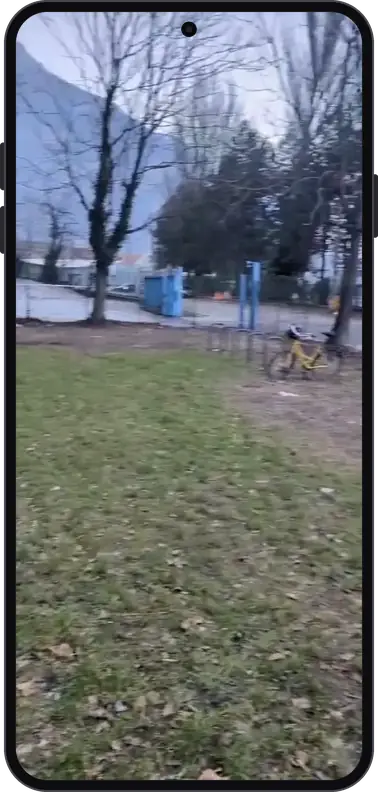
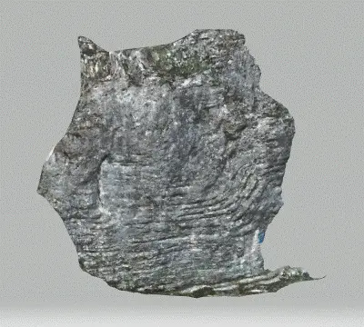

# Rope Climbing AR Guide

**A mobile AR prototype that overlays climbing routes onto a real rock face.** 

> [!NOTE]
> This is a very-early research prototype. It was built for the Human-Computer Interaction course at ENSIMAG (Grenoble), with the goal of evaluating the improvement AR-Topos might bring over traditional topology in terms of speed.

## Demo

<table>
  <tr>
    <td align="center" width="50%">
       
      Phone recording of the guide, with a route overlaid on the wall.
    </td>
    <td align="center" width="50%">
       
      A 3D scan of one of the rock face that the routes were traced from. This was recorded with photogrammetry.
    </td>
  </tr>
</table>

## How it works

### Moderator mode

1. Scan the wall until AR planes are detected.
2. Tap two points on the wall to place anchors: the start of the route and a second reference hold.
3. The selected route, a 3D polyline traced from a scan of the rock, gets translated, scaled and rotated so its first two points line up with the two anchors.

### Evaluation mode

Switching to evaluation mode hides the moderator UI and all plane and feature-point visualizations, so the climber sees only the camera feed and the route. A six-finger tap switches back to moderator mode.

## Running it

1. Open the project in **Unity 6000.6.6f1**, with Android and/or iOS build support.
2. Build to an ARCore (Android) or ARKit (iOS) device.
3. To try it in the editor, enable **XR Simulation** under *Project Settings → XR Plug-in Management* and pick one of the rock environments in the XR Environment view.

## Use of AI tools

The app itself was built without LLM coding assistance. An agent was used afterwards to clean up the repository and polish the README for publishing.

## Credits

Based on Unity's [AR Foundation Samples](https://github.com/Unity-Technologies/arfoundation-samples) (6.0.3), which provides the UI and AR scaffolding. The sample code is licensed under the Unity Companion License; see [LICENSE.md](LICENSE.md).
